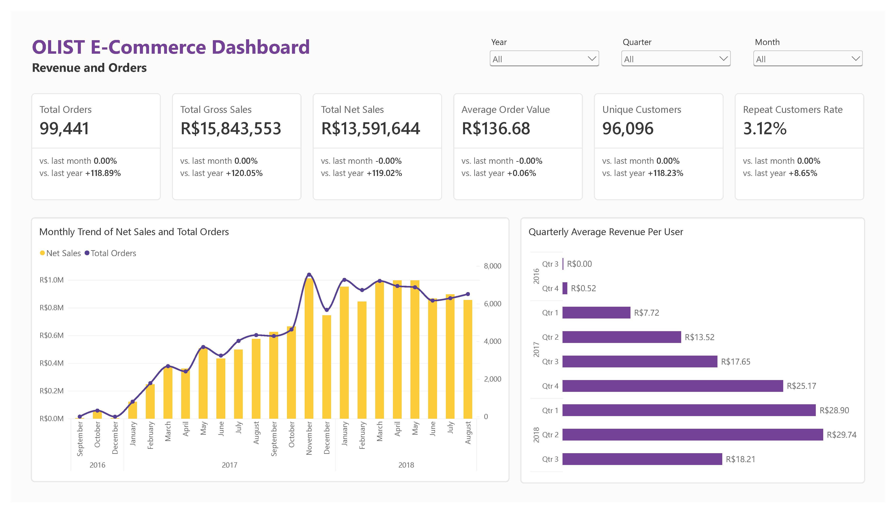
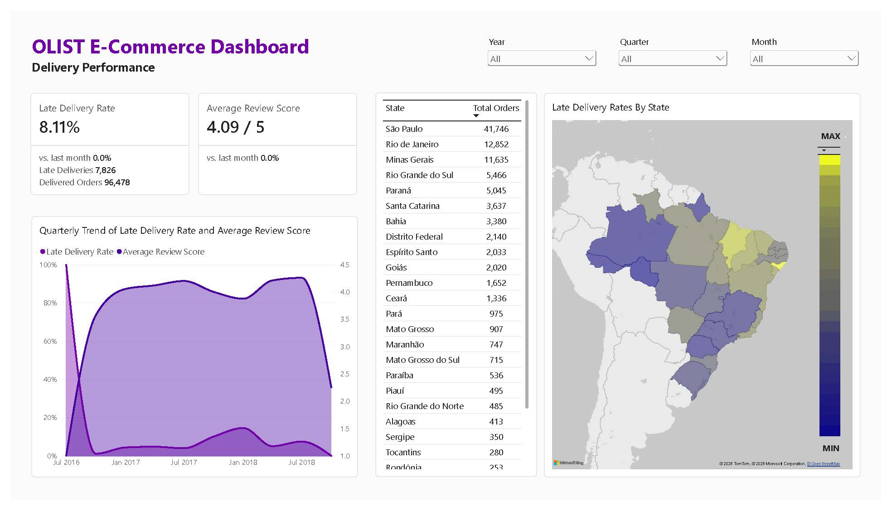
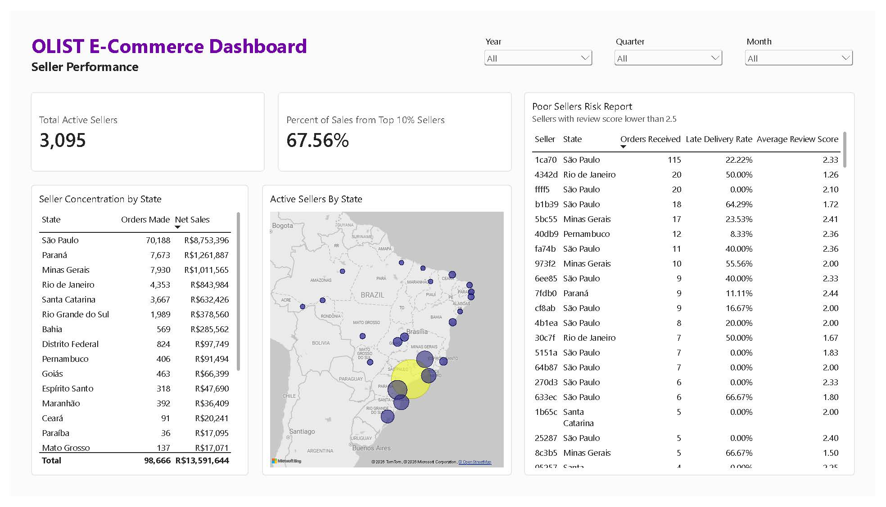

# ASB Case Study 4B – Building an End-to-End E-Commerce Dashboard

This project implements a [case study from the Analytics Solutions Bootcamp (Josh Dev PH)](https://github.com/imjbmkz/analytics-solutions-bootcamp/blob/main/03_case_study/04_cs02_business_intelligence.md) of building an end-to-end business intelligence dashboard using the [Brazilian E-Commerce Public Dataset by Olist](https://www.kaggle.com/datasets/olistbr/brazilian-ecommerce). More specifically, it involves cleaning raw datasets, defining proper relational grains, building a analytical/semantic model, calculating business KPIs, and delivering an interactive dashboard that supports descriptive and diagnostic analysis.

## Situation

Olist is a Brazilian e-commerce marketplace that connects small businesses and sellers to online marketplaces. Sellers offer their products through Olist, while customers place orders that are fulfilled by the respective sellers and delivered through logistics partners.

The available data covers approximately 100,000 anonymized orders from 2016 to 2018 and provides information across different parts of the order lifecycle, including:

- Customers and their locations
- Orders and order status
- Products and product categories
- Sellers
- Order items, prices, and freight values
- Payment methods and installments
- Delivery dates and estimated delivery dates
- Customer review scores and comments

Management currently has access to transactional data but needs a consolidated dashboard to better understand the performance of the marketplace.

We are asked to develop an **analytics solution** (specifically an end-to-end business intelligence dashboard) that allows management to monitor **sales performance, customer behavior, product performance, and order fulfillment** and identify areas where the business can improve.

## Setup

1. Fork the repository then clone locally on your machine.
2. [Download and install uv](https://docs.astral.sh/uv/#installation)
3. [Download and install Docker](https://docs.docker.com/get-started/get-docker/)
4. While in the working directory, follow the following commands:

```bash
# Create virtual environment
uv venv --python 3.14

# Sync virtual environment to install dependencies
uv sync

# Optional: Include packages from dependency groups
uv sync --group dev

# Create your .env from the template
cp env.example .env

# Initialize containers
docker compose up -d

# Launch setup
uv run setup_db.py
```

- The environment utilizes a Python script for setup and ingestion, Docker for running containers, PostgreSQL and DuckDB for relational data storage and SQL transformations, and Power BI for DAX metric generation and dashboard visualization.
- The DuckDB database and PostgreSQL container can be viewed and queried using [CloudBeaver](https://github.com/dbeaver/cloudbeaver/) (defined in the compose file) or with any applicable database management tool.
- The dashboard can be opened using [Power BI Desktop](https://www.microsoft.com/en/power-platform/products/power-bi/desktop) (Windows only).

## Directory Overview

```markdown
cs4-bi/
├── analytics/                  # Queries for creating views within the database representing the analytical/semantic model 
├── data/                       # Directory for data files, automatically created during setup
│   ├── duckdb/                 # Default directory for the generated DuckDB database file during setup
│   └── raw/                    # Default directory for the downloaded raw datasets during setup
├── report/                     # Dashboard report export
├── compose.yaml                # Compose for running containers
├── dashboard.pbix              # Power BI dashboard file
├── env.example                 # .env template, commit this
├── pyproject.toml              # Project configuration file
└── setup_db.py                 # Setup and ingestion script
```

## Data Preparation

1. In the setup script, raw CSV files are downloaded and loaded into a database (DuckDB and PostgreSQL container) in the following tables. Note that `asb_oltp` is the name of the database and `kaggle` is the name of the schema.
    - `asb_oltp.kaggle.product_category_name_translation`
    - `asb_oltp.kaggle.olist_geolocation_dataset`
    - `asb_oltp.kaggle.olist_order_items_dataset`
    - `asb_oltp.kaggle.olist_order_payments_dataset`
    - `asb_oltp.kaggle.olist_customers_dataset`
    - `asb_oltp.kaggle.olist_products_dataset`
    - `asb_oltp.kaggle.olist_sellers_dataset`
    - `asb_oltp.kaggle.olist_orders_dataset`
    - `asb_oltp.kaggle.olist_order_reviews_dataset`
2. By running the query scripts in `analytics/`, the created views handles data typing, product category translations, and geolocation deduplication.
3. The database (DuckDB or PostgreSQL container) can then be connected to a BI tool, loading the created views for data analysis.

## Analytical/Semantic Model Overview

- The raw entity relationships feature the case of **mixed granularity**. For instance, consider the following tables.
    - `olist_orders_dataset` has a grain of one row per order.
    - `olist_order_items_dataset` has a grain of one row per item within an order (orders can contain multiple items from different sellers and products).
    - `olist_order_payments_dataset` has a grain of one row per payment transaction/installment (a single order can be split across vouchers, credit cards, etc.).
- Suppose an order has 2 items and 2 payment methods, flattening them into a single denormalized table results in 4 rows (2 x 2). Aggregating `SUM(price)` or `SUM(payment_value)` on such tables doubles the actual values.
- Among options, a constellation (multi-fact) star schema was used for the model, maintaining separate fact tables at their respective grains connected through shared (conformed) dimensions.
- The model assumes that missing category translations can be defaulted to "unknown", that order timestamps map logically to a standard calendar, and that canceled orders without line items are intentionally excluded from item-level financial aggregations.
- [Read more about the details of the model.](./docs_analytical_model.md)

## Key Business Metrics

- Total Orders
- Gross and Net Revenue (Sales)
- Average Order Value (AOV)
- Total Unique Customers and Repeat Customer Rate
- Late Delivery Rate
- Average Review Score
- Total Active Sellers and Percent of Sales from Top Sellers (10%)

## Dashboard Overview

- The dashboard is mainly composed by three pages covering Unit Economics (`revenue`), Fulfillment Efficiency (`delivery`), and Network Health (`seller`). An additional page for supplementary visuals used for analysis was also included in the dashboard file.





## Business Insights and Recommendations

### Insight 1: The platform suffers from "leaky bucket" unit economics

- Considering all records from 2016 to 2018, the repeat customers rate shows that less than 5% of all unique customers return for a second purchase.
- This shows the marketplace operates almost entirely as a single-purchase acquisition engine.
- Profitability in doing e-commerce relies on Customer Lifetime Value (LTV). Constantly paying to acquire users who only buy once is financially unsustainable in the long term.

### Insight 2: Late deliveries devastate brand equity

- Looking at a plot of late delivery rate vs. average review score by state, the pattern shows that as the former increases the latter decreases.
- Then looking at a supplementing bar chart of the average review score by delivery status (on-time and late), orders delivered on or before the estimated date maintain an average review score of about 4.2, whereas late deliveries plummet to an average score of about 2.1.
- This shows that there is a severe and quantifiable penalty to customer satisfaction when delivery fulfillment is breached.
- A low average score almost guarantees customer churn, which also supports why the repeat purchase rate is low. Logistics failures are actively destroying brand trust.

### Insight 3: High revenue concentration in the southeast part of the country

- Both demand (customers) and supply (sellers) are overwhelmingly concentrated in the southeast states, while northern states face severe delivery friction.
- The map visual indicates that northern states experience average delivery times exceeding 20 days and significantly higher freight ratios.
- The business is heavily reliant on one geographic cluster. The friction of high shipping costs and slow transit prevents Olist from capturing market share in the rest of the country.

## Business Recommendations

1. **Enforce Strict Merchant Quality SLAs** - To protect the network's health, Olist must implement automated penalties for toxic sellers. Sellers who exceed a 15% late delivery rate or maintain an average review score below 3.0 should be deprioritized in search results or temporarily suspended from the platform.
2. **Launch a Post-Purchase Retention Program** - To improve unit economics, Olist must deploy targeted re-engagement campaigns. Customers should receive automated incentives (e.g., free shipping or discounts) 30 days after a successful, highly-rated first purchase to convert them into repeat buyers and drive up LTV.

## Disclosures

Generative AI tools were utilized in this project.

- Learning Assistance: AI tools were used to guide the author in parsing references and applying the concepts in the module.
- Drafting: The initial code logic and documentation were authored by the human user.
- Refinement: AI tools were used to iteratively improve, debug, and optimize the initial drafts.
- Review & Validation: All AI outputs and suggested modifications were critically reviewed, manually tested, and validated by the author.

The author assumes full responsibility for the final logic, data interpretations, and conclusions presented in this work.
