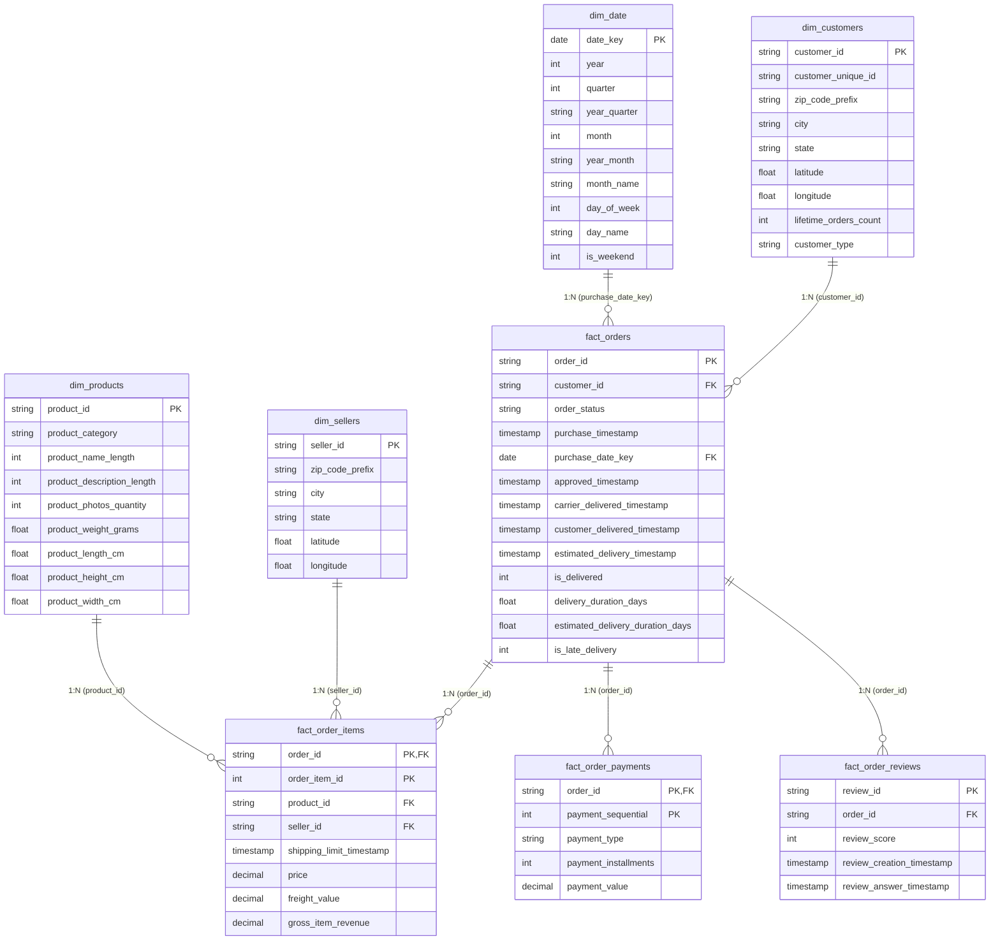

# Analytical/Semantic Model

The analytical model utilizes a constellation/multi-fact star schema. Instead of flattening the entire e-commerce dataset into a single massive table—which causes catastrophic data duplication and metric inflation—the model separates data into shared contextual dimensions and isolated event-driven fact tables based on their precise business granularities.

## ER Diagram

## Dimensional Layer - Context

The dimensions serve as the "Who, What, Where, and When" of the marketplace. These are the lookup tables containing unique, non-duplicated entities used for filtering and slicing the dashboard visuals.

- `dim_customers`: Granularity is one row per unique customer location. It deduplicates the raw geolocation dataset to link `customer_id` directly to their `city`, `state`, and `zip_code_prefix`.
- `dim_sellers`: Granularity is one row per unique seller. Similar to the customer dimension, it ties `seller_id` to operational geographies to enable logistical mapping and regional delivery tracking.
- `dim_products`: Granularity is one row per unique item. It maps `product_id` to physical specifications (`weight_g`, `photos_qty`) and utilizes a joined mapping table to natively translate Portuguese categories into English.
- `dim_date`: A standard calendar dimension linked to the various lifecycle timestamps (purchase date, approved date, delivered date) to enable time-intelligence DAX functions and cohort analysis.

## Fact Layer - Metrics and Events

The fact tables store the quantitative business events. By isolating these into four distinct tables, the model guarantees that metrics (like freight value or review scores) are accurately calculated even when a single order behaves unexpectedly.

- `fact_orders` (Header Grain): One row equals one checkout event. It stores the exact timestamps of the fulfillment lifecycle (estimated vs. actual delivery date) and the overarching `order_status` (including canceled or unavailable orders that lack line items).
- `fact_order_items` (Line-Item Grain): One row equals one physical product sold. This is the core financial table containing `price`, `freight_value`, and foreign keys bridging to both `dim_sellers` and `dim_products`.
- `fact_payments` (Transaction Grain): One row equals one payment method used. If a customer splits an order between a credit card and a voucher, it generates two distinct rows here, both tied back to the parent `order_id`.
- `fact_order_reviews` (Feedback Grain): One row equals one customer survey response, storing the exact 1-to-5 `review_score`.

## Resolving Grain and Filtering Flow

Because the schema is a constellation rather than a simple star, the `fact_orders` table acts as a central bridge mechanism.

The primary technical challenge in this architecture is the single-direction flow of filters. In a standard BI model, relationships flow strictly 1-to-Many. If a user clicks a specific `product_category` in `dim_products`, the filter successfully flows down into `fact_order_items`. However, it natively stops there. To calculate the average review score for that specific product category, the filter must traverse "upstream" from `fact_order_items` into `fact_orders`, and then back down into `fact_order_reviews`.

This was resolved dynamically using the `CROSSFILTER(..., BOTH)` DAX pattern. Instead of turning on hardcoded bi-directional cross-filtering (which creates ambiguous paths and severely degrades dashboard processing speed), the measure activates the reverse filter path only for the microsecond that specific calculation computes, preserving the overall integrity of the model.
