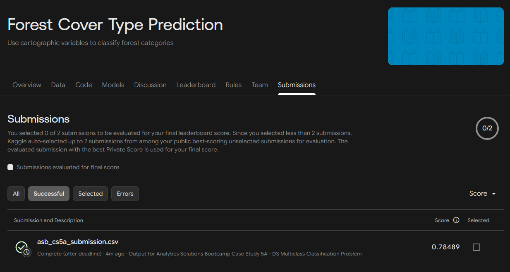
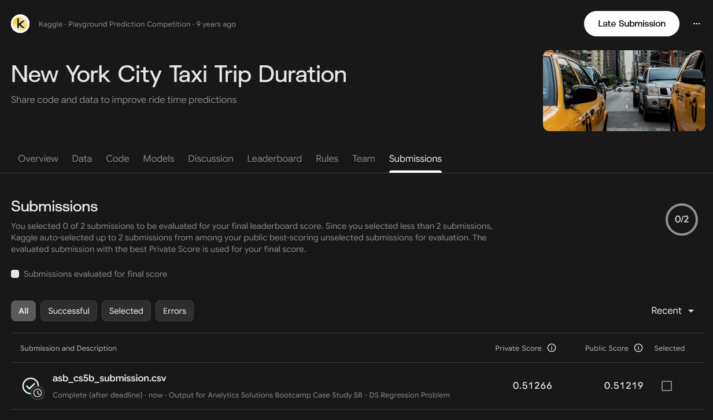

# ASB Case Study 5

This case study from the [Analytics Solutions Bootcamp](https://github.com/imjbmkz/analytics-solutions-bootcamp/tree/main) covers the following parts:

- DS/ML Classification Problem (Case Study 5A) -> `nb_cs5a_cls.ipynb`
- DS/ML Regression Problem (Case Study 5B) -> `nb_cs5b_reg.ipynb`

## Kaggle submission

**Case Study 5A**

**Case Study 5B**

