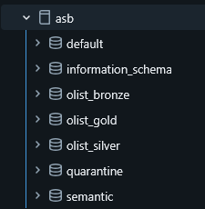
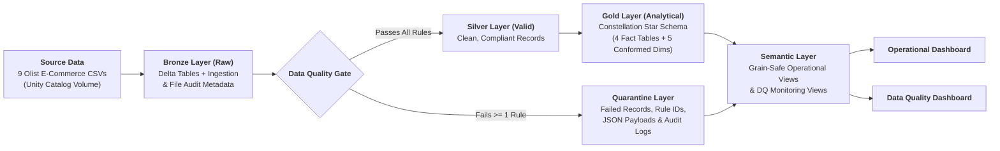
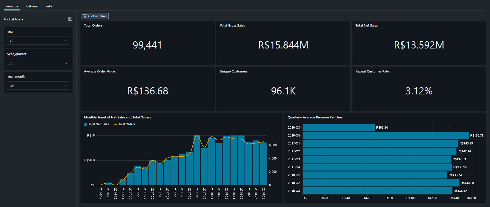
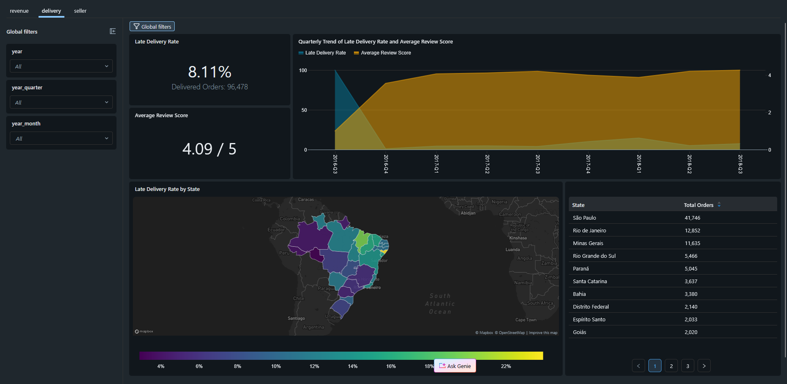
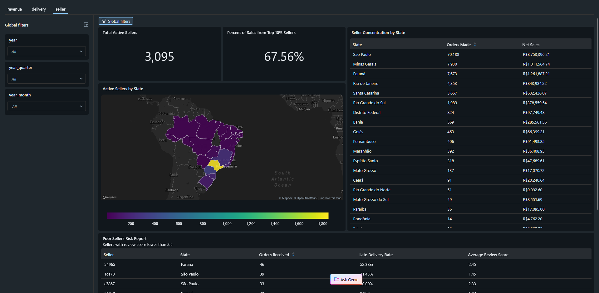
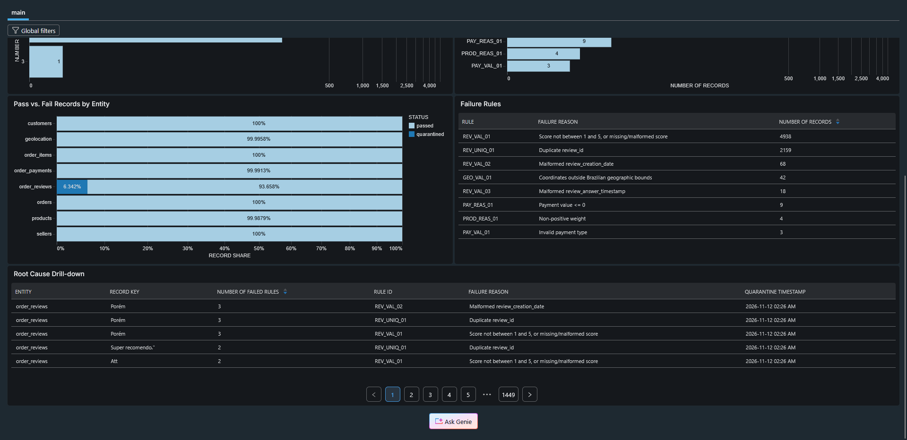
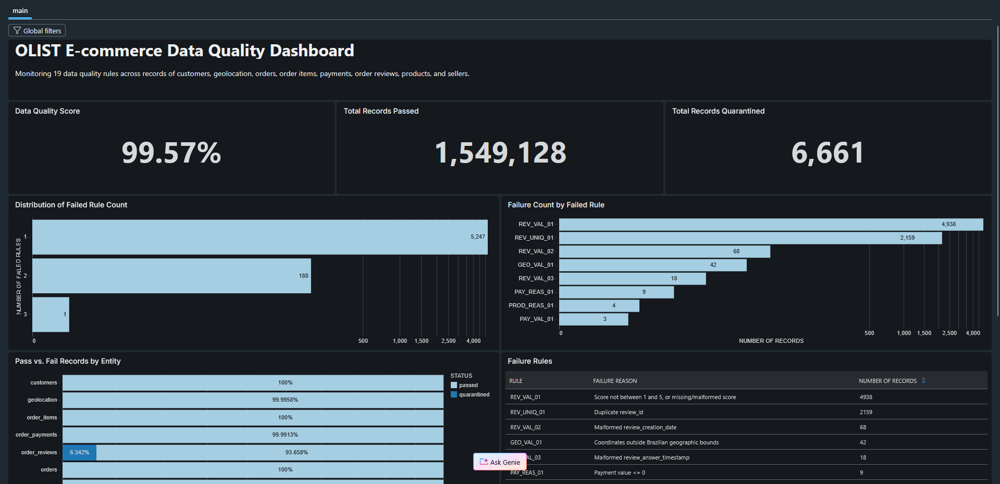

# ASB Case Study 6 – Data Governance and Analytics on Databricks

This project implements a [case study from the Analytics Solutions Bootcamp (Josh Dev PH)](https://github.com/imjbmkz/analytics-solutions-bootcamp/blob/main/03_case_study/06_cs_data_governance.md) of implementing data governance using the [Brazilian E-Commerce Public Dataset by Olist](https://www.kaggle.com/datasets/olistbr/brazilian-ecommerce). More specifically, it involves rebuilding the data pipeline and dashboard from [Case Study 4B](../cs4/cs4b-bi/) with data governance practices and data quality controls. The end tangible product is the analytics dashboard that supports descriptive and diagnostic analysis like before and a data quality dashboard that monitors valid and invalid records in the pipeline.

## Situation

We previously built an end-to-end dashboard solution using the Olist dataset. For this case study, we will revisit that solution and rebuild the data pipeline and dashboard in Databricks, while introducing data governance and data quality controls.

The objective is not only to produce analytics, but to ensure that the data used by the analytical solution is trustworthy. Our pipeline must identify records that satisfy our data quality requirements, isolate records that fail those requirements, and ensure that only valid records are propagated to the analytical layer.

## Setup files

Upload the following notebooks and files into your own Databricks workspace.

```bash
cs6-dg/
├── 00_nb_setup.ipynb                               # Download raw file and save to bronze layer volume
├── 01_nb_bronze_layer_setup.ipynb                  # Raw file ingestion and exploratory data profiling within bronze layer
├── 02_nb_silver_layer_setup.ipynb                  # Data validation and transfer to silver layer
├── 03_nb_gold_layer_setup.ipynb                    # Setup dimension and fact tables in gold layer
├── 04_nb_semantic_layer_setup.ipynb                # Setup analytics views for BI in semantic layer
├── 05_nb_data_quality_view_setup.ipynb             # Setup data quality views in semantic layer
├── 06_nb_post_validation.ipynb                     # Post validation script
├── olist_data_quality_dashboard.lvdash.json        # Data quality dashboard
└── olist_ecommerce_dashboard.lvdash.json           # Analytics dashboard
```

Note the setup use the following catalog and schema name.

- Catalog: `asb`
- Schemas:
    - `olist_bronze`
    - `olist_silver`
    - `olist_gold`
    - `quarantine`
    - `semantic`



Tables can be called using the following syntax: `catalog.schema.table_name`

## Architecture



## Data model and data quality rules

- For the data model, it remains the same as the [constellation schema](../cs4/cs4b-bi/docs_analytical_model.md) created before but now lies in the Gold layer.
- See the following [document](./data_quality_rules.md) for the data quality rules.

## Analytics dashboard





## Data quality dashboard




## Disclosures

Generative AI tools were utilized in this project.

- Learning Assistance: AI tools were used to guide the author in parsing references and applying the concepts in the module.
- Drafting: The initial code logic and documentation were authored by the human user.
- Refinement: AI tools were used to iteratively improve, debug, and optimize the initial drafts.
- Review & Validation: All AI outputs and suggested modifications were critically reviewed, manually tested, and validated by the author.

The author assumes full responsibility for the final logic, data interpretations, and conclusions presented in this work.
